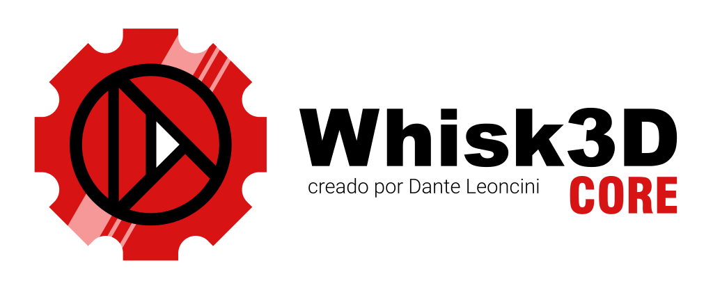

# Whisk3D Core

    

## Retro-style 2D and 3D Cross-Platform Engine

Whisk3D Core is a cross-platform 3D engine. It is a library written in C++ for creating lightweight 2D/3D games and applications that run on both modern and retro systems. It provides a unified graphics API that abstracts the differences between various rendering APIs and operating systems, allowing you to write once and run on Windows, Linux, Android, Symbian, and web browsers (more systems may be added in the future).

Its design prioritizes simplicity, performance, and portability, taking inspiration from classic engines like RenderWare and making it ideal for low-spec projects or those with a retro aesthetic.

**NOTE:** The project is not yet production-ready. Changes and rewrites are still actively ongoing! If you have any questions, feel free to ask in the [Telegram](https://t.me/Whisk3D) group.

Currently, I am continuing to clean up the Core to:
- Simplify the code... it still contains a lot of logic from Whisk3D Editor (edit mode, object mode, render modes, Mesh Editor, Modifiers—all of that does NOT belong in the Core)
- Polish animations
- Add a skeletal animation system
- Add a BSP-style system for maps or another system for open worlds
- A physics system... though that might be optional, similar to BSP
- Support other retro platforms and graphics backends
- Add examples and documentation (examples will be continuously uploaded to the [Whisk3D-Examples](https://github.com/Dante-Leoncini/Whisk3D-Examples) repository)

## Current Capabilities

What the Core already does today:

- **Supported systems:** Windows, Linux, Android, Symbian, and web browsers (WebGL). The exact same codebase runs on all of them; each platform only supplies its window/context initialization.
- **Graphics backends:** A *fixed-function pipeline* backend (Desktop OpenGL and OpenGL ES 1.1 for Android/Symbian) and a *shader* backend (OpenGL ES 2.0 / WebGL). Selected at compile time, both implement the same state API, so high-level code remains unchanged. (Vulkan and DirectX are planned for later.)
- **Unified graphics API (no visible OpenGL):** The entire application draws through `w3dEngine` (render states, matrices, vertex arrays, materials, fog, blending, scissor test, lines, and points...) without ever making direct OpenGL calls or depending on OpenGL headers.
- **Texture loading:** `w3dEngine::LoadTexture(path, ...)` opens an image from disk and uploads it as a texture (decoded via stb on PC/Android and ICL on Symbian; texture upload logic is shared). Also includes `DecodeImage` to obtain raw RGBA pixels (sprites, etc.), with linear or nearest filtering.
- **Lighting system:** `Light` class supporting directional, point, and spot lights, configurable attenuation, and ambient/diffuse/specular components. Up to 8 lights per scene.
- **Camera:** Reusable `CameraBase` class (position, quaternion orientation, FOV, near/far clipping planes) that feeds its view and perspective projection matrices to the renderer.
- **Logging system:** Diagnostic logging shared across platforms with three levels (info / warning / error). On desktop and Symbian, it writes to a file with tags; on WebGL, each level maps to `console.log` / `console.warn` / `console.error`. Uses a printf style and can be completely disabled in release builds.
- **Math utilities:** Custom vectors, 4x4 matrices, and quaternions (pure C, compiles identically on PC and retro systems).
- **Scene and geometry:** Meshes with vertices/normals/UVs/per-vertex color, materials, object graph with hierarchical transformations (parent/child), and animations.

Whisk3D Core includes the fundamental components of a 3D engine, including:

- Rendering pipeline abstraction.
- Mesh and geometry representation.
- Materials and textures.
- Cameras and view management.
- Lighting system.
- Scene objects and transformations.
- Vertex and index buffers.
- Basic render states.
- Math utilities (vectors, matrices, and quaternions).

The project is designed to simplify the implementation of new graphics backends (such as OpenGL, OpenGL ES, WebGL, Vulkan, Direct3D, Metal, or software renderers) without requiring modifications to the engine's high-level code.

## Its Primary Goals Are:

- Cross-platform compatibility.
- Graphics API independence.
- Clean and modular architecture.
- Lightweight and easy to port.
- Compatible with desktop computers, mobile devices, embedded systems, and retro platforms.

Whisk3D Core forms the foundation of the Whisk3D engine and editor, but it can also be used as a standalone rendering framework for other projects.

The code is under the MIT license, so you can use it in your own projects (whether open-source or commercial), fork it, modify it, etc.
